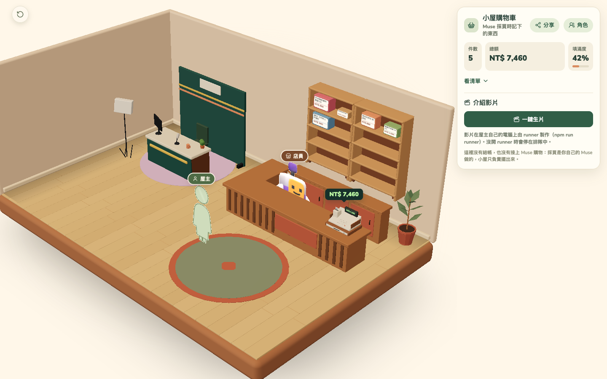
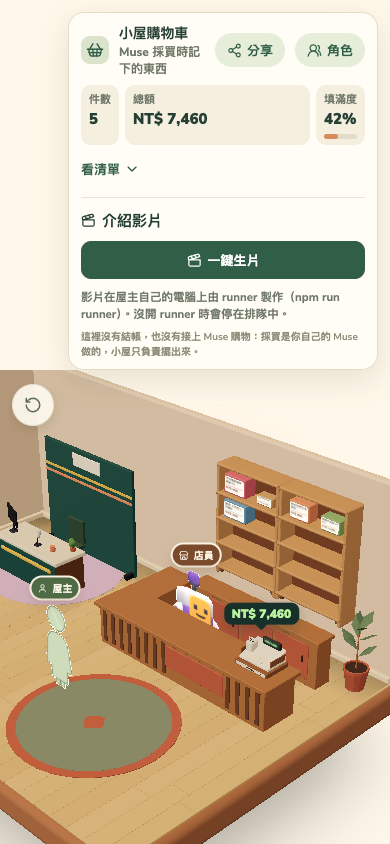
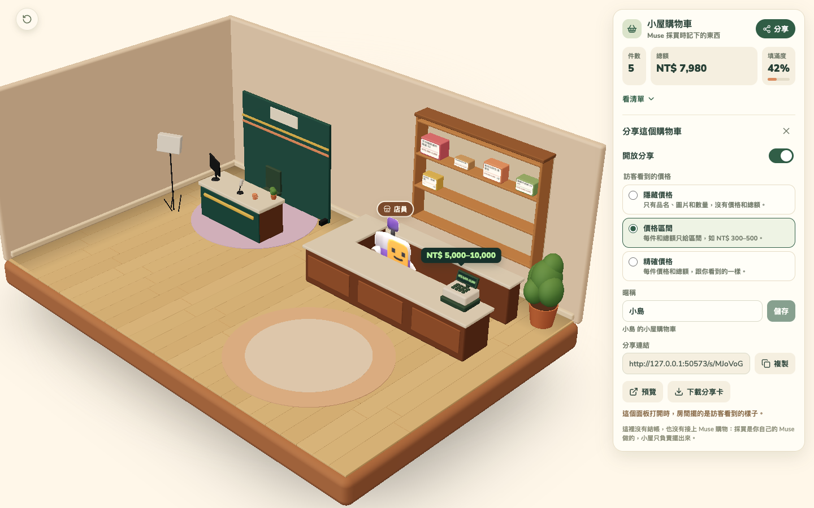
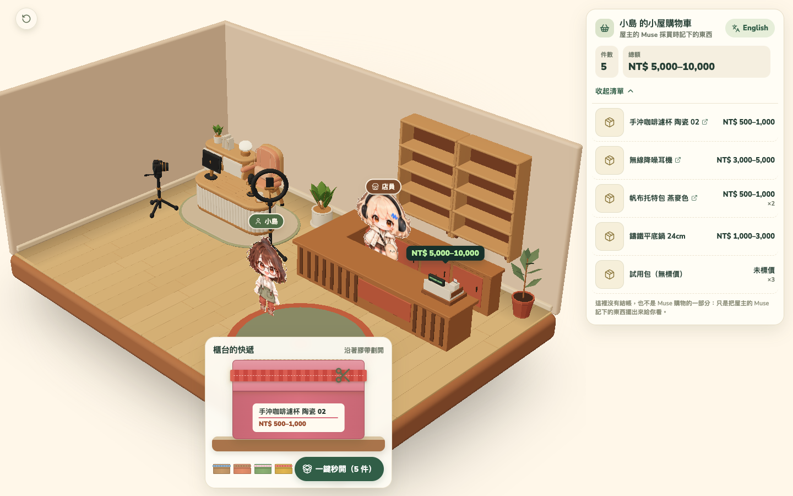

# pacafe-cart-showroom／小屋購物車

> 本專案不是 Meta Muse 產品的整合，也沒有結帳。採買由使用者自己的 Muse 完成；小屋購物車只把「囤在購物車裡的東西」畫成看得見的房間。住民 agent 用 Meta Model API／Muse Code（muse-wonder-1.0、muse-spark-1.3）當大腦。

小屋購物車是一個 3D 小房間。Muse 採買時記下的東西會擺上櫃台後面的貨架，一件佔一格；櫃台上的收銀機顯示總額，囤得越多，貨架越滿。房間每 2 秒讀一次購物車，所以新記下的東西會自己出現。

| 桌機 1440×900 | 手機 390×844 |
|---|---|
|  |  |

## 在本機執行

需要 Node 26。

1. 安裝套件。

   ```bash
   npm ci
   ```

2. 建置前端，再用 wrangler 在本機跑 Worker 和 Durable Object。

   ```bash
   npm run dev:worker
   ```

   打開 http://127.0.0.1:8877 。`dev:worker` 用 `wrangler.jsonc` 的 `env.local`（`OPEN_OWNER_ACCESS=true`）：這台機器上的任何人都算屋主，可以讀寫購物車和分享設定，第一次讀取時放進 5 件 fixture（`shared/fixtures/cart.ts`）。資料存在 `.local/state`。

3. 寫入購物車。下一次輪詢（每 2 秒一次）時，櫃台就多一個快遞箱；拆開之後，東西才擺上貨架（見下面的「拆快遞」）。

   ```bash
   curl -X POST http://127.0.0.1:8877/api/cart \
     -H 'content-type: application/json' \
     -d '{"items":[{"title":"陶瓷馬克杯","store":"小島陶房","priceTwd":420,"qty":2},{"title":"亞麻餐墊","priceTwd":290}]}'
   ```

要改前端並即時重新整理，在另一個終端機跑 `npm run dev`。Vite 會把 `/api` 轉給 8877 埠上的 `dev:worker`。

### 檢查

```bash
npm run build       # vite build，輸出到 dist/client
npm run typecheck   # tsc --noEmit
npm test            # vitest run
```

CI（`.github/workflows/ci.yml`）在每次 push 和 pull request 跑這三項，不需要 secret，也不需要瀏覽器。

### 腳本

| 指令 | 做什麼 |
|---|---|
| `npm run verify:persist` | 用真的 `wrangler dev` 寫入購物車，關掉再重開同一個 `--persist-to` 目錄，確認讀回來的購物車一樣。 |
| `npm run verify:mcp` | 用真的 `wrangler dev` 走一遍住民的流程：`initialize`、`tools/list`、記兩件、`cart_list`、移除一件、排介紹片、查進度，再確認 `/api/cart` 讀到同一個購物車，以及沒有 token 和 token 錯誤都回 401。token 每次隨機產生，不會印出來。 |
| `npm run verify:runner` | 用真的 `wrangler dev` 扮演 runner：排隊、`/runner/next` 認領、回報 `storyboard`、`voice`、`rendering`、上傳假的 mp4 和 jpg、`done`，再確認 `promo_status`、`/api/promo` 和 `/media/promo/...` 看到同一支片、讀到上傳的位元組；也檢查沒 token 回 401、沒有 job 回 204、沒上傳就 `done` 回 409。token 隨機產生，不會印出來。 |
| `npm run verify:adapter` | 對真的 `wrangler dev` 跑 `adapter/cli.ts --dry-run`，再用本機的假 Model API 跑一輪，確認東西進了購物車。見 [adapter 說明](adapter/README.md)。 |
| `npm run verify:share` | 用真的 `wrangler dev`（有 token、`OPEN_OWNER_ACCESS=false`，跟正式環境一樣）走分享流程：`/api/cart` 沒 token 回 401；開分享後依序切 hidden、range、exact 檢查 `/s/<slug>` 的 JSON；關分享後回 404。 |
| `node scripts/screenshots.mjs` | 建置、啟動 `wrangler dev --env local`，先把 5 個快遞箱都記成拆過，等貨架擺上 5 件商品後存 `docs/screenshots/desktop.png` 和 `mobile-390.png`。 |
| `npm run screenshots:share` | 存房間分享面板和訪客分享頁的截圖（1440 和 390 寬，range 模式）到 `docs/screenshots/`。設了 `SHARE_SCREENSHOTS_COPY_TO` 會另外複製一份到那個目錄。 |
| `node scripts/screenshots-unbox.mjs` | 用真的 `wrangler dev` 跑一遍拆快遞：桌機用滑鼠、390 寬用真的觸控事件（CDP）劃開一件、沒劃完就放手、劃開上架、再一鍵秒開，每一步存一張圖到 `UNBOX_SCREENSHOTS_DIR`（預設 `.local/screenshots-unbox`）。設 `UNBOX_REDUCED_MOTION=1` 會開「減少動態」再跑一次。 |
| `node scripts/render-character.mjs` | 把 Kenney 的 CC0 角色算成 `public/art/characters/clerk-standee.png`、`clerk-portrait.png`，和綠色版 `clerk-mint-*.png`。 |
| `node scripts/screenshots-cast.mjs` | 存角色面板和房間（換店員前後、C 位剪影、沒金鑰的說明、用假 Meta API 生成的角色、訪客頁）的截圖到 `$CAST_SCREENSHOTS_DIR`，1440 和 390 寬各一套。 |
| `node scripts/generate-studio-set.mjs` | 用 three.js 基本形狀產生主播台棚景 `public/studio/showroom-set.glb`。 |
| `node tools/meta-hackathon/probe/run-all.ts --dry-run` | 不呼叫 API，印出 Meta Model API 探針的請求和費用估算。見 [探針說明](tools/meta-hackathon/probe/README.md)。 |

截圖和算圖腳本需要 Playwright 的 Chromium（`npx playwright-core install chromium`），用 SwiftShader 在沒有 GPU 的機器上畫 WebGL。

### 正式環境的屋主權限

正式環境的 `/api/cart`（讀和寫）和 `/api/share` 只回應帶 `Authorization: Bearer <CART_MCP_TOKEN>` 的請求，其餘回 401。房間第一次被擋時會請屋主輸入這把金鑰，存在瀏覽器的 localStorage，之後每次讀寫都帶上。用 `wrangler secret put CART_MCP_TOKEN` 設定 token；token 不放進任何檔案。`.env.example` 只列出變數名稱。

`/mcp` 在任何環境都要這個 token，`env.local` 也一樣。在本機用 MCP 時，把 token 寫進 `.dev.vars`（已列在 `.gitignore`），再跑 `npm run dev:worker`：

```bash
echo "CART_MCP_TOKEN=$(openssl rand -base64 24)" > .dev.vars
```

## `/api/cart`

| 請求 | 回應 |
|---|---|
| `GET /api/cart` | `200`，`Cart`。沒有 token 回 `401`（`env.local` 除外）。 |
| `POST /api/cart`，body `{ "items": CartItemInput[] }` | `200`，取代後的 `Cart`。body 不對回 `400`，沒有 token 回 `401`。 |

- `CartItemInput` 是 `{ title, store?, url?, priceTwd?, imageUrl?, qty? }`，`qty` 預設 1，`url` 和 `imageUrl` 只接受 http 或 https。一次最多 50 件。
- `Cart` 是 `{ revision, items: CartItem[], totalTwd, fill, updatedAt }`。`CartItem` 多了 `id`、`cutoutUrl`、`addedAt`、`shelfSlot`。schema 在 `shared/cart.ts`。
- `totalTwd` 是每件 `priceTwd × qty` 的總和，沒標價的算 0。
- 貨架有 12 格（3 層 × 4 格）。每件依清單順序佔一格，`fill = min(1, 件數 / 12)`；超過 12 件的照樣算進總額，但擺不上貨架。
- 同樣的內容寫兩次，回來的是同一個購物車，`revision` 不變。標題、店名和連結不變的東西，會保留原本的 `id` 和 `addedAt`。

## 拆快遞：`/api/unbox`

購物車裡的東西不是直接擺上貨架，而是先變成快遞箱送到櫃台。屋主用手指或滑鼠沿著膠帶劃開，商品跳出來飛上貨架；箱子多的時候有「一鍵秒開（N 件）」，全部一起拆。全部拆完後，櫃台的快遞介面自己收起來。

| 請求 | 回應 |
|---|---|
| `GET /api/unbox`（屋主） | `200`，`{ opened: { <itemId>: <ISO 時間> } }`。只列還在購物車裡的東西。 |
| `POST /api/unbox`（屋主），body `{ "itemIds": string[] }`（1 到 50 個） | `200`，新的 `{ opened }`。body 不對回 `400`，沒有 token 回 `401`。 |

- 沒有紀錄的東西就是箱子。第一次載入時 fixture 的 5 件全是箱子。紀錄存在 Durable Object 的 `unbox` key，形狀在 `shared/unbox.ts`。
- `POST` 可以重送：已經拆過的保留原本的時間，不在購物車裡的 id 直接略過，同時刪掉已經不在購物車的紀錄。
- 屋主的貨架只畫拆過的商品；收銀機的總額照舊算整個購物車。訪客的分享頁和 `/s/<slug>` 不變，看得到整個購物車。
- 每個箱子走 `arriving`、`atCounter`、`slicing`、`opened`、`shelved` 五個階段（`src/cart/unbox.ts` 的 reducer）。膠帶劃過 85% 就打開；沒劃完就放手，箱子回到 `atCounter`，劃痕歸零，下一次重劃。商品跳出來的動畫放完、`POST` 成功之後才變 `shelved` 並出現在貨架上；寫入失敗會每 2 秒重試，箱子留在畫面上。
- 介面疊在 `main` 底下、房間外面，所以一指劃動不會被房間的雙指相機手勢吃掉。箱子可以用鍵盤的 Enter 或空白鍵打開；系統開了「減少動態」就沒有動畫。
- 測試用的掛鉤：`data-testid="unbox"`（介面）、`unbox-box`（每個箱子，帶 `data-item-id`、`data-phase`）、`unbox-tape`（膠帶）、`unbox-all`（秒開鈕）。

## 分享：`/api/share` 和 `/s/<slug>`

屋主在房間按「分享」打開設定。分享預設關閉，訪客看到的價格預設隱藏。

| 請求 | 回應 |
|---|---|
| `GET /api/share`（屋主） | `200`，`{ slug, enabled, prices, nickname, url }`。第一次問時建立。 |
| `PUT /api/share`（屋主），body `{ enabled, prices, nickname }` | `200`，同上。三個欄位都要給；`slug` 不能改。body 不對回 `400`。 |
| `GET /s/<slug>`，`Accept: application/json` | 分享開著時 `200`，`ShareView`；其餘一律同一個 `404 {"error":"not_found"}`。 |
| `GET /s/<slug>`，瀏覽器 | 分享開著時回 app 的 `index.html`，`<title>` 和 `og:title` 是「{暱稱} 的小屋購物車」，`og:description` 是「{n} 件東西」，不放價格；其餘回同一個純文字 404 頁。 |

- `prices` 是 `hidden`（只有品名、圖片、數量）、`range`（每件和總額給區間，如 `NT$ 300–500`）或 `exact`（精確價格和總額）。`nickname` 1 到 24 字，預設「屋主」。
- `ShareView` 用 `mode` 標明模式，每種模式各有一個嚴格的形狀（`shared/share.ts`）：`hidden` 沒有任何價格欄位，`range` 只有 `priceRange` 和 `totalRange`。沒有 item id、店名、revision。商品連結去掉 query、`#` 和帳號密碼；圖片網址照原樣給（有去背圖時給去背圖）。
- `/s/` 的回應都帶 `cache-control: no-store`、`vary: accept`、`referrer-policy: no-referrer`、`x-robots-tag: noindex`。slug 錯、格式不對、從沒建立、已關閉，回的 404 一模一樣。只接受 `GET`。
- `npm run verify:share` 用真的 `wrangler dev`（有 token、不開 `OPEN_OWNER_ACCESS`）走一遍上面全部；`npm run screenshots:share` 存分享面板和分享頁的截圖。

| 房間的分享面板 | 訪客的分享頁 |
|---|---|
|  |  |

## 角色與 C 位

屋主在房間按「角色」打開面板。選擇存在屋主設定裡（Durable Object 的 `cast`），重新整理和換裝置都會保留。

**櫃台後的店員。** 有四個可選，圖都不是從別的專案搬來的：

| id | 名稱 | 來源 |
|---|---|---|
| `clerk` | 店員 | Kenney 的 CC0 角色 |
| `clerk-mint` | 薄荷店員 | 同一個 Kenney 角色，紫色換成綠色（`scripts/render-character.mjs`） |
| `apron` | 圍裙店員 | 用程式畫的 SVG（`src/room/characterArt.ts`） |
| `cap` | 帽子店員 | 用程式畫的 SVG（`src/room/characterArt.ts`） |

**C 位是屋主本人。** 房間中間（櫃台左前方的地板）站一個代表屋主的立牌，名牌是分享設定的暱稱，預設「屋主」。還沒有自己的角色時，站的是程式畫的中性剪影。屋主可以選一張自己的照片，勾選「這是我本人，並同意用這張照片生成角色」，按「請 Muse 生成」：伺服器透過 Meta Model API 使用 Meta 的 Muse 模型（`muse-image-1.0`）畫一張 chibi 全身立牌。

| 請求 | 回應 |
|---|---|
| `GET /api/cast`（屋主） | `200`，`{ character, owner, nickname, spriteGeneration }`。`owner` 是 `{ kind: 'placeholder' }` 或 `{ kind: 'generated', key, generatedAt, model }`。 |
| `PUT /api/cast`（屋主），body `{ character }` | `200`，同上。`character` 不在清單裡回 `400`。 |
| `POST /api/cast/owner-sprite`（屋主），multipart：`photo`（JPEG 或 PNG，2 MB 以內）、`consent=true` | `200`，同上。沒勾同意或照片不對回 `400`，太大回 `413`，沒設 Meta 金鑰回 `503`，模型失敗回 `502`。 |
| `DELETE /api/cast/owner-sprite`（屋主） | 改回剪影，並刪掉生成的圖。 |

- 沒有 `META_API_KEY` 和 `META_API_BASE_URL`（都用 `wrangler secret put` 設）時，`GET /api/cast` 回 `spriteGeneration: { available: false, reason: 'needs_meta_api_key' }`，面板的按鈕是灰的並說明要設什麼；`POST` 回 `503`，完全不呼叫外部 API。
- 送出的請求固定帶 `enable_image_search: false`，prompt 是固定範本，不含任何品牌或產品名稱。模型的錯誤內容和金鑰都不會回給前端；失敗一律是 `502 { error: 'generation_failed' }`。
- 生成的 PNG 存在 R2 的 `owner/sprite-<uuid>.png`，`customMetadata` 記 `aiGenerated: 'true'`、`model`、`generatedAt`、`enableImageSearch: 'false'`。照片只在這次請求裡轉給模型，不存。面板在圖旁標「AI 生成（Muse Image）」。
- **隱私：生成的角色只出現在屋主自己的房間。** 讀圖走 `/media/owner/...`，要屋主金鑰，前端用 `ownerFetch` 取回再轉成 object URL。訪客的 `/s/<slug>` 回應和頁面都不含它，C 位一律畫剪影、名牌是分享暱稱。分享面板開著時，房間也照訪客看到的樣子畫（剪影加預設店員），下載的分享卡才不會漏出來。
- 訪客看到的店員目前一律是預設的「店員」，不跟著屋主的選擇走。
- `node scripts/screenshots-cast.mjs` 用本機假的 Meta API（127.0.0.1，假金鑰，程式畫的 PNG）存面板和房間的截圖到 `$CAST_SCREENSHOTS_DIR`，不會打真的 API。

## `/mcp`

住民 agent（例如 Muse Code）用這個端點把採買過的東西記進小屋。協定是 JSON-RPC over streamable HTTP，支援 `2025-11-25` 和 `2025-06-18`。每個請求都要帶 `Authorization: Bearer <CART_MCP_TOKEN>`，沒有 token、token 錯誤或伺服器沒設 token 都回 `401`。

伺服器不保存 session，每個 POST 回一個 JSON。支援 `initialize`、`ping`、`tools/list`、`tools/call`。不開 SSE 串流，所以 `GET /mcp` 回 `405`。

工具固定 5 支：

| 工具 | 輸入 | 回傳 | 唯讀 |
|---|---|---|---|
| `cart_add` | `{ title, store?, url?, priceTwd?, imageUrl?, qty? }`，`qty` 預設 1 | `Cart` | 否 |
| `cart_list` | `{}` | `Cart`，加上 `share: { url, enabled, prices }` | 是 |
| `cart_remove` | `{ itemId, qty? }`，不給 `qty` 就整件移除 | `Cart` | 否 |
| `promo_generate` | `{ durationSec?, style? }`，`durationSec` 介於 15 到 45，預設 30 | `{ jobId, status: 'queued' }` | 否 |
| `promo_status` | `{ jobId }` | `PromoJob` | 是 |

- `cart_add` 遇到標題、店名、連結都相同的東西，會把數量加上去，不會多佔一格。購物車最多 50 件。
- 分享不另開工具。分享連結只出現在 `cart_list` 的 `share.url`，格式是 `https://<主機>/s/<slug>`，不帶 query。slug 是 16 bytes 的 crypto 亂數（22 個 base64url 字元），第一次需要時產生並保存。`enabled` 預設 `false`，`prices` 預設 `hidden`。開關分享、選價格顯示方式和暱稱只能由屋主在房間裡做，見上面的「分享」。
- 參數不對、購物車是空的、找不到 `itemId` 或 `jobId` 時，工具回 `isError: true` 的結果，訊息寫給模型看，讓它修正後重試。工具名稱不存在時回 JSON-RPC 錯誤 `-32602`。
- 型別在 `shared/cart.ts`、`shared/promo.ts`、`shared/share.ts`，工具在 `worker/tools.ts`，傳輸在 `worker/mcp.ts`。

### 介紹片：排隊、runner 和房間的一鍵生片

`promo_generate` 會建立並保存一筆真的 job。job 記下當下的 `cartRevision`、片長、風格和整個購物車快照，狀態是 `queued`、`progress` 0。同一份購物車、同樣的參數在 job 還在排隊時重送，回來的是同一個 `jobId`，避免重試時排兩支要付費的片。工具和房間的按鈕共用同一個 `queuePromo()`（`worker/promo.ts`），所以兩邊排的是同一種 job。

片不是 worker 做的。worker 只管排隊、發工作和收成品；算圖在屋主自己的電腦上由 runner（`npm run runner`）做，它用 token 來 pull。沒開 runner 時 job 會一直停在 `queued`，住民只能用 `promo_status` 輪詢，小屋不寫 webhook，也不推播。worker 和 runner 之間的合約寫在 `shared/runner.ts`，worker 這邊在 `worker/runner.ts`。

**排隊和租約。** 還沒做完的 job 依排入順序存在 `promo:queue`（id 陣列），做完（`done` 或 `failed`）就移出。`POST /runner/next` 取出最早一個「還在排隊」或「租約已過期」的 job，設成 `storyboard`、`progress` 0，記下租約，回傳 `RunnerClaim`。租約每次認領和每次更新都延長 `RUNNER_LEASE_MS`（20 分鐘），租約和認領時間放在 `PromoRecord`，不會出現在 `promo_status`。runner 掛掉安靜超過租約後，下一次 `/runner/next` 會把那個 job 從 `storyboard` 重做一次，所以認領是 idempotent 的：沒過期時再叫一次拿不到同一個 job。這一輪重做時 `progress` 會回到 0，`costUsd` 保留上一輪的值，直到新的 runner 回報。

**runner 看到的購物車。** claim 裡的 `view` 是 `shareView(job 排入時的購物車, 屋主現在的分享設定)`：只有屋主選的價格模式和暱稱，不管分享有沒有打開。價格選隱藏時，claim 裡沒有任何價格欄位，影片就拿不到價格。

| 路由 | 做什麼 |
|---|---|
| `POST /runner/next` | 200 `RunnerClaim`，沒有 job 時 204。 |
| `POST /runner/jobs/<id>` | body 是 `RunnerUpdate`，回 200 `PromoJob`。照 `PROMO_STEPS` 檢查，不能這樣走回 409，job 不存在回 404，body 不對回 400。 |
| `PUT /runner/jobs/<id>/media/<name>` | 原始檔案，`name` 是 `video.mp4`、`thumbnail.jpg` 或 `qa.json`，大小上限 50 MB，只在 job 正在做（不是 `queued`、也還沒到終點）時收，回 `{ key, url }`。檔案存在 R2 的 `promo/<id>/<name>`。 |

三條路由都要 `Authorization: Bearer <CART_MCP_TOKEN>`，`env.local` 也一樣。更新規則：

- 同一個狀態內 `progress` 只會前進。回報的值比已存的小，worker 保留已存的值、仍回 200，因為 runner 分不出重送和錯誤，回 409 只會讓它誤以為整個 job 壞了。換到新狀態時 `progress` 從回報的值開始。
- `done` 不帶網址。worker 先確認 `promo/<id>/video.mp4` 和 `thumbnail.jpg` 都已在 R2，缺任何一個就回 409，再用請求的 origin 組出 `output.videoUrl` 和 `thumbnailUrl`，加上 runner 給的 `sha256`、`durationSec`。所以不會有沒有影片的 done job。
- `failed` 存 runner 給的 `error`。`costUsd` 每次都存 runner 回報的累計值。
- 影片檔走 `/media/promo/<id>/video.mp4`，知道 job id 的人都能讀，支援 byte range，所以可以拖進度。

**房間的一鍵生片。** HUD 的「介紹影片」面板（`src/promo/PromoPanel.tsx`）只給屋主：

| 路由 | 做什麼 |
|---|---|
| `POST /api/promo` | body 是 `{ durationSec?, style? }`（跟 `promo_generate` 一樣），回 `{ jobId, status }`。購物車是空的回 409 `empty_cart`。 |
| `GET /api/promo` | 最新一筆 `PromoJob`，沒排過就是 `null`。 |

按下「一鍵生片」排隊，之後每 3 秒讀一次 `GET /api/promo`，到 `done` 或 `failed` 停。面板顯示排隊中、分鏡、配音、算圖、完成或失敗，加進度條；完成時顯示縮圖當封面的影片（可播放）和下載連結；失敗時顯示錯誤和「重試」。購物車是空的時按鈕停用並說明原因。面板上有一句說明：影片在屋主自己的電腦上由 runner 製作，沒開 runner 時會停在排隊中。

`npm run verify:runner` 用 HTTP 扮演 runner 走完整條路，見上面的腳本表。

### 接上 Muse Code

`muse/settings.example.json` 是 Muse Code 的 `mcp_servers` 設定範例，token 用 `${CART_MCP_TOKEN}` 從環境變數帶入。skills 在 `.agents/skills/`：

| skill | 做什麼 |
|---|---|
| `showroom-cart` | 用 `cart_add`、`cart_list`、`cart_remove` 記下、查看、移除東西 |
| `showroom-promo` | `promo_generate` 之後每 15 秒 `promo_status`，直到 `done` 或 `failed`，回報成片和分享連結 |

Demo 任務在 `muse/demo-task.txt`：

```bash
muse exec --prompt-file muse/demo-task.txt --disable-approval --max-model-steps 60 --json
```

介紹片要屋主的電腦開著 runner（`npm run runner`）才做得出來。沒開 runner 時 job 會停在 `queued`，任務會照 skill 等到 20 分鐘上限後照實回報。

## 賽前搬來／賽中新寫

| 部分 | 路徑 | 來源 | 賽前搬來／賽中新寫 |
|---|---|---|---|
| 3D 房間：相機、燈光、地板牆面、日光、站立卡、棚景載入、觸控相機 | `src/room/`（`furnitureModels.ts` 除外）、`src/video/ease.ts`、`src/browserStorage.ts` | pa-cafe `s10-studio-desk`（a48a6b66） | 賽前搬來，刪減 |
| 剪輯桌與房間角落元件 | `src/components/` | pa-cafe `s10-studio-desk` | 賽前搬來，刪減 |
| 房間共用設定 | `shared/` 的 `room-*.ts`、`scenery.ts`、`performance-script.ts`、`locales.ts`、`sprites.ts`、`safe-decode.ts`、`studio.ts`、`domain.ts`、`starter-furniture.ts` | pa-cafe `s10-studio-desk` | 賽前搬來，刪減 |
| 介面字串、樣式 | `src/i18n/`、`src/world.css` | pa-cafe `s10-studio-desk` | 賽前搬來，只留用到的部分 |
| Meta Model API 探針、計畫書 | `tools/meta-hackathon/probe/`、`docs/PLAN.md` | agentic-remotion-studio `meta-hackathon/2026`（0a0bc75） | 賽前搬來，刪減 |
| 購物車資料形狀與推導、fixture | `shared/cart.ts`、`shared/fixtures/cart.ts` | 無 | 賽中新寫 |
| Worker 與 Showroom Durable Object | `worker/index.ts`、`worker/showroom.ts`、`worker/env.ts`、`wrangler.jsonc` | 無 | 賽中新寫 |
| MCP 傳輸 | `worker/mcp.ts` | 參考 pa-cafe main 的 `worker/streamable-mcp.ts`、`worker/protocol.ts` | 賽中重寫：只留 JSON-RPC 和協定協商，刪掉配對、Clerk session、簽章、版本偏差 |
| 5 支 MCP 工具、介紹片 job、分享設定 | `worker/tools.ts`、`shared/promo.ts`、`shared/share.ts` | 無 | 賽中新寫 |
| skills、Muse Code 設定範例、demo 任務 | `.agents/skills/`、`muse/` | 無 | 賽中新寫 |
| Model API function calling 轉 MCP 的備援 | `adapter/` | 無 | 賽中新寫 |
| 貨架商品、收銀機、HUD、輪詢、拆快遞 | `src/cart/`、`src/App.tsx`、`shared/unbox.ts` | 無 | 賽中新寫 |
| 櫃台、貨架、植物、地毯、收銀機的 3D 模型 | `public/furniture/*.glb`（7 個，共 543,340 bytes），內容與 pa-cafe 的檔案逐位元組相同 | pa-cafe `public/furniture/` 的 `terra__bar`、`atelier__item_01_archive_bookshelf`、`terra__plant`、`terra__plant_cactus`、`terra__rug_round`、`terra__rug_star`、`terra__counter_classic_cash_register`（commit 7d7b8364，sha256 見下面的「搬來的家具模型」） | 賽前搬來，沒有改動 |
| 載入這些模型、把書櫃拼成貨架、算出 12 個商品格的位置、收銀機螢幕位置 | `src/room/furnitureModels.ts`、`tests/furniture-models.test.ts` | 無 | 賽中新寫 |
| 角色算圖、棚景產生、截圖、持久化驗證、MCP 驗證 | `scripts/` | 無 | 賽中新寫 |
| 測試 | `tests/` | 無 | 賽中新寫 |

pa-cafe 房間的 import 閉包有 214 檔、約 3.6 萬行。住民、任務、額度、書櫃、多樓層、窗戶實驗和經濟機制都刪掉了，家具只搬了上面那 7 個 GLB，其餘的都沒有搬。

## 搬來的家具模型

房間裡的櫃台、貨架、植物、地毯和收銀機是 pa-cafe 已經做好的 GLB，不是這個專案畫的。`public/furniture/` 裡的檔案跟 pa-cafe 的原檔逐位元組相同，`tests/furniture-models.test.ts` 用 sha256 比對。

| 檔案 | bytes | pa-cafe 的檔案 | sha256 | 用在哪裡 |
|---|---|---|---|---|
| `terra-counter.glb` | 79,864 | `terra__bar` | `228374296d47…` | L 形櫃台，跟原本的尺寸一樣：前檯、左邊的回轉、後面的櫃子 |
| `atelier-archive-bookshelf.glb` | 251,868 | `atelier__item_01_archive_bookshelf` | `9b11a579fc2a…` | 貨架：兩座並排放大 1.2 倍，載入時拿掉書和盆栽，四層裡上面三層是 12 個商品格 |
| `terra-plant.glb` | 27,692 | `terra__plant` | `f2bbae54a061…` | 櫃台旁的植物，`size` 照舊縮放 |
| `terra-plant-cactus.glb` | 51,100 | `terra__plant_cactus` | `7df23ed39e82…` | 植物的 `cactus` 款 |
| `terra-rug-round.glb` | 13,984 | `terra__rug_round` | `419967e1dbce…` | 地毯 |
| `terra-rug-star.glb` | 8,604 | `terra__rug_star` | `194fb6967b17…` | 地毯的 `star` 款 |
| `terra-cash-register.glb` | 110,228 | `terra__counter_classic_cash_register` | `1dabc59dd3d0…` | 櫃台上的收銀機，螢幕上貼總額 |

- 三個系列混用：櫃台、植物、地毯、收銀機是 PA Cafe 預設的 terra 系列，書櫃是 atelier 系列。terra 的 `bookcase` 有固定的隔板，`beanShelf` 只有一排罐子，放不下 12 格；atelier 的書櫃拿掉書之後四層都是空的、沒有隔板。
- 商品格的位置從書櫃自己的層板量出來（`furnitureModels.ts` 的 `unit`），不是散在各處的數字。`tests/furniture-models.test.ts` 對 12 格各射光線：腳下是層板、頭上和左右都有空間、後面是背板。
- 貨架第四層（最下面一層）沒有商品格，保持空著。購物車最多 12 格，見上面的「`/api/cart`」。
- 模型下載需要一點時間：房間在模型到齊（或 4 秒）之後才顯示，載入失敗的那件留著單色方塊的替身，商品格仍然在原位。
- 櫃台的 `walnut`、`oak` 兩款現在用同一個 terra 櫃台，看不出差別。

pa-cafe 記錄這些檔案的方式：`assets/furniture/README.md` 和 `sources.json` 記錄身分與 sha256，`collection-provenance.json` 記錄書櫃來自 `PA_Cafe_Atelier_Objects_V04`；收銀機的 `assets/furniture/countertop/README.md` 寫「十個為 PA Cafe 做的原創 Blender GLB，原稿是原創，沒有複製第三方素材」。pa-cafe 沒有為這些模型另外寫授權條款。它們是同一位作者的原創作品，這個專案在 Apache-2.0 下一併發布它們，見 [THIRD_PARTY.md](THIRD_PARTY.md)。

## 開源素材

| 素材 | 用在哪裡 | 出處 | 作者 | 授權 |
|---|---|---|---|---|
| Starter Kit 3D Platformer 的 `character.glb`、`Textures/colormap.png` | 店員立牌和頭像（`scripts/render-character.mjs` 算圖） | https://github.com/KenneyNL/Starter-Kit-3D-Platformer ，commit 3fa8a04b | Kenney | CC0 1.0 |
| Nunito Sans（`@fontsource-variable/nunito-sans` 5.3.0） | 介面字型 | https://github.com/Fonthausen/NunitoSans | The Nunito Sans Project Authors | SIL OFL 1.1 |
| Lucide 圖示（`lucide-react` 1.54.0） | 介面圖示 | https://github.com/lucide-icons/lucide | Lucide Icons and Contributors | ISC |
| 主播台棚景 `public/studio/showroom-set.glb` | 房間左邊的棚景 | 本 repo，`scripts/generate-studio-set.mjs` | pacafe-cart-showroom authors | Apache-2.0（原創） |

所有第三方素材和套件列在 [THIRD_PARTY.md](THIRD_PARTY.md)。

## 授權

Apache-2.0，見 [LICENSE](LICENSE) 和 [NOTICE](NOTICE)。
